<!--
  GitHub Profile README
  Dynamic cards are provided by external services and may occasionally be unavailable.
-->

  &nbsp;
  &nbsp;
  &nbsp;
  

---

## About Me

I'm **Gowsika E.**, a Computer Science and Engineering student at **V.S.B College of Engineering Technical Campus** (2024–2028).

- Focused on **Java, Data Structures and Algorithms, and Full Stack Development**.
- Solved **200+ problems on LeetCode** through consistent practice.
- Building applications with **React, Node.js, Express, and MongoDB**.
- Exploring **Spring Boot** and backend engineering.
- Interested in internships, collaborative projects, and opportunities to build practical software.

> My goal is to become a software engineer who builds reliable, scalable, and user-focused products.

## Tech Stack

**Languages**

**Frontend**

**Backend, Databases & Tools**

## Featured Projects

<table>
<tr>
<td width="50%" valign="top">

### AirTrace AI

**ML · React · Node.js · MongoDB**

An air-pollution source attribution platform estimating possible emission sources across monitoring zones.

- Random Forest source classification
- GIS visualisation and pollution trends
- AI-generated advisories and alerts
- Portfolio-reported model accuracy: **96.3%** (dataset/evaluation dependent)

[Repository](https://github.com/gowsika911/Air-Trace-AI) · [Live Demo](https://air-trace-ai.vercel.app/)

</td>
<td width="50%" valign="top">

### Smart AI Medicine Box

**MERN · AI · REST API**

An AI-assisted medication tracking and compliance project.

- Medication adherence monitoring
- Compliance scoring based on missed or delayed doses
- JWT-authenticated workflow
- Team lead for a four-member team

[Repository](https://github.com/gowsika911/smart-ai-medicine-box)

</td>
</tr>
<tr>
<td width="50%" valign="top">

### Pulse-Sync

**MERN · Enterprise Application**

An employee resource and knowledge management platform.

- Employee skill mapping
- Resource and team management
- JWT authentication and role-based access
- Knowledge sharing and video learning

[Repository](https://github.com/gowsika911/Sync-Pulse)

</td>
<td width="50%" valign="top">

### More Projects

Explore my repositories for additional academic, experimental, and personal projects.

[Browse all repositories](https://github.com/gowsika911?tab=repositories)

</td>
</tr>
</table>

## GitHub Statistics

## LeetCode

**200+ problems solved** · Data Structures · Algorithms · Problem Solving

## Achievements

| Achievement | Result |
|---|---|
| LeetCode | 200+ problems solved |
| B.E. Computer Science and Engineering | 8.97 CGPA |
| NPTEL Programming in Java | Silver Elite · 80% |
| NPTEL Computer Networks | Elite · 81% |
| Smart AI Medicine Box | Patent application reference: 202641075807 A1 |

## Internships

- **Web Development Intern — Nxtlogic Software Solutions, Coimbatore** · June–July 2026
- **Full Stack Web Development Intern — Pantech Solutions** · May–June 2025

## Certifications

<strong>View certifications</strong>

| Certification | Issuer | Result |
|---|---|---|
| Computer Networks (2026) | NPTEL — IIT Indore | Elite · 81% |
| React Native (2026) | Infosys Springboard | Completed |
| Programming in Java (2025) | NPTEL — IIT | Silver Elite · 80% |
| Full Stack Web Development (2025) | Pantech Solutions | Internship Certificate |

## Education

<strong>B.E. Computer Science and Engineering · 2024–2028</strong>

**V.S.B College of Engineering Technical Campus**  
Currently pursuing · **8.97 CGPA**

Focus areas: Full Stack Development, Data Structures and Algorithms, Object-Oriented Programming.

<strong>Class XII — Higher Secondary · March 2024</strong>

**V.V.M. Matriculation Higher Secondary School, Coimbatore**  
**87.5%**

## Connect With Me

| Platform | Profile |
|---|---|
| Portfolio | [gowsika-portfolio.vercel.app](https://gowsika-portfolio.vercel.app/) |
| GitHub | [@gowsika911](https://github.com/gowsika911) |
| LeetCode | [@Gowsika2006](https://leetcode.com/u/Gowsika2006/) |
| LinkedIn | [Gowsika Eswaran](https://www.linkedin.com/in/gowsika-eswaran-9b4996364) |
| Email | [gowsika911@gmail.com](mailto:gowsika911@gmail.com) |

 

*Building, learning, and improving one project at a time.*

